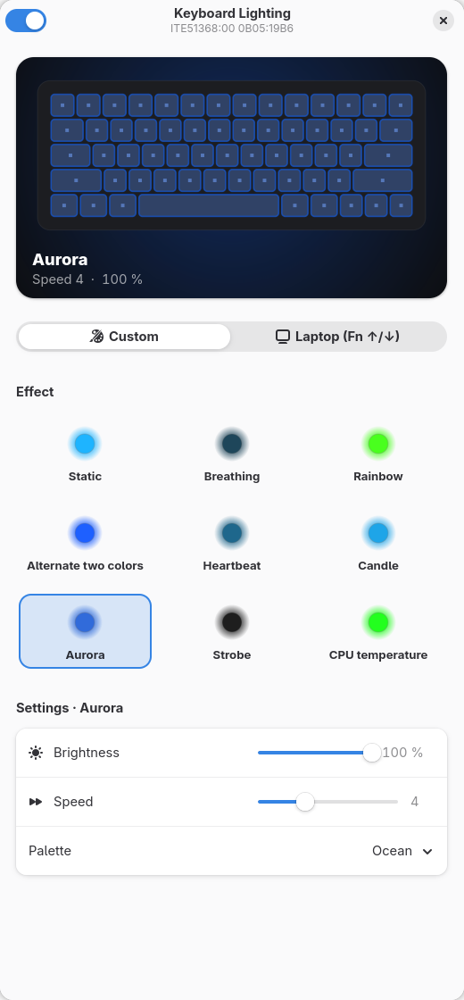

# lamparray-light

[English](README.md) · **Español**

Control de la iluminación RGB de dispositivos **HID LampArray** en Linux: el estándar
abierto detrás de la *Iluminación dinámica* de Windows 11, que usan teclados de
portátiles y periféricos de muchos fabricantes. Habla directamente con el dispositivo,
así que funciona donde `asusctl`, OpenRGB o las herramientas del fabricante no dan
soporte al hardware.



## Dispositivos compatibles

Cualquier dispositivo cuyo descriptor de informes HID exponga una colección LampArray,
por I2C, USB o Bluetooth. Los números y tamaños de los informes se leen del descriptor,
así que no hace falta configuración por modelo.

| Dispositivo | Estado |
|---|---|
| ASUS TUF Gaming A16 (FA608UM), teclado interno `ITE51368` `0B05:19B6` | ✅ probado |
| Otros teclados / dispositivos LampArray | deberían funcionar, se agradecen informes |

Comprueba si tu equipo tiene un dispositivo LampArray:

```sh
for d in /sys/class/hidraw/*; do
  od -An -v -tx1 "$d/device/report_descriptor" | tr -dc 0-9a-f |
    grep -q -e 05590901a101 -e 0659000901a101 && grep HID_NAME "$d/device/uevent"
done
```

Tras instalar, `kbd-light info` lista los dispositivos detectados con sus números de
informe y su número de LEDs.

## Funcionalidades

- **Aplicación GTK4 / libadwaita** con vista previa en directo de la iluminación.
- **Color e intensidad**, con selector de color y colores rápidos.
- **9 efectos**, cada uno con sus opciones:

  | Efecto | Opciones |
  |---|---|
  | Estático | — |
  | Respiración | brillo mínimo, curva |
  | Arcoíris | saturación, sentido |
  | Alternar dos colores | segundo color, fundido / corte |
  | Latido | brillo en reposo, pulso simple / doble |
  | Vela | intensidad del parpadeo |
  | Aurora | paleta (Boreal, Atardecer, Océano, Bosque, Lava) |
  | Destellos | duración, destellos por ráfaga |
  | Temperatura de la CPU | umbrales frío / caliente, alarma |

- **Modo portátil**: devuelve el control al firmware (p. ej. Fn + ↑/↓).
- **Varios dispositivos a la vez**: controla juntos todos los LampArray que encuentre.
- **Servicio de usuario** que anima los efectos y restaura la configuración al iniciar
  sesión y al volver de suspensión.
- **Línea de comandos** `kbd-light`.
- **9 idiomas**: inglés, español, alemán, francés, portugués, italiano, ruso, japonés y
  chino simplificado (sigue el idioma del sistema).

## Requisitos

- Python 3, PyGObject con GTK 4 y libadwaita ≥ 1.7, pycairo
  (en Fedora con GNOME ya vienen instalados).
- systemd (servicio de usuario) y udev.
- `gettext` (`msgfmt`) para instalar las traducciones; sin él la interfaz sale en inglés.

## Instalación

```sh
git clone https://github.com/<usuario>/lamparray-light.git
cd lamparray-light
./install.sh
```

El script instala la app para tu usuario en `~/.local` y pide `sudo` solo para la regla
udev que da acceso a los dispositivos LampArray a la sesión activa (sin necesidad de
root después).

Para desinstalar: `./uninstall.sh` (añade `--purge` para borrar también la configuración).

## Uso por línea de comandos

```sh
kbd-light                      # abre la aplicación
kbd-light info                 # dispositivos detectados, informes y LEDs
kbd-light color ff6600 80      # color fijo al 80 %
kbd-light effect rainbow 7     # efecto y velocidad (1-10)
kbd-light color2 00aaff        # segundo color (alternate)
kbd-light auto                 # control del firmware
kbd-light off                  # apagar
```

Efectos: `static`, `breathing`, `rainbow`, `alternate`, `heartbeat`, `candle`,
`aurora`, `strobe`, `cputemp`.

La configuración se guarda en `~/.config/kbd-light/config.json`.

## Cómo funciona

Un LampArray es una colección de aplicación en la página de uso HID *Lighting and
Illumination* (`0x59`). `kbd-light` recorre `/sys/class/hidraw/*/device/report_descriptor`,
analiza cada descriptor y se queda con los dispositivos que implementan los informes
necesarios. Después envía *feature reports* por `/dev/hidrawN`:

| Informe (por uso) | Para qué sirve |
|---|---|
| LampArrayAttributes (`0x02`) | nº de LEDs, tamaño, intervalo mínimo de actualización |
| LampAttributesRequest / Response (`0x20` / `0x22`) | posición y capacidades de cada LED |
| LampRangeUpdate (`0x60`) | color RGBI para un rango de LEDs |
| LampArrayControl (`0x70`) | modo autónomo (firmware) on/off |

Los números de informe cambian entre fabricantes (el teclado ASUS usa `0x41`–`0x46`), por
eso se leen del descriptor.

La regla udev da acceso con la etiqueta `uaccess` a los nodos hidraw cuyo descriptor
contiene la colección LampArray, así que solo afecta a dispositivos de iluminación.

El servicio de usuario genera los efectos a ~30 fps (o más despacio si el dispositivo lo
pide) y pone todos los LEDs del mismo color; los efectos por LED aún no están
implementados.

### Por qué hace falta en portátiles ASUS

En el modelo ASUS probado, el teclado va por I2C y Linux lo enlaza a `hid-generic` (el
driver `hid-asus` solo lo reconoce por USB), y la interfaz WMI de retroiluminación
(`asus::kbd_backlight`, la que usa `asusctl`) acepta órdenes sin ningún efecto.

## Traducciones

Las traducciones están en `po/`. Para añadir un idioma:

```sh
cd po
msginit -l <idioma> -i kbd-light.pot -o <idioma>.po   # y traduce <idioma>.po
echo <idioma> >> LINGUAS
./update.sh                                             # comprueba todos los catálogos
```

Si cambias textos en `src/`, ejecuta `po/update.sh` para actualizar la plantilla y los
catálogos. Las traducciones actuales están hechas con ayuda de IA: se agradecen
correcciones de hablantes nativos.

## Estructura

```
src/kbd_light.py        núcleo: protocolo LampArray, efectos, CLI y servicio
src/kbd_light_gui.py    interfaz GTK4 / libadwaita
src/i18n.py             configuración de gettext
po/                     plantilla y catálogos de traducción
data/                   regla udev, servicio systemd de usuario y lanzador .desktop
install.sh              instalación para el usuario actual
uninstall.sh            desinstalación
```

## Licencia

[MIT](LICENSE) © 2026 Rodrigo Vaamonde
