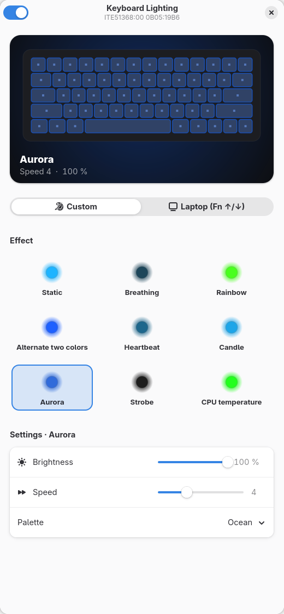

# lamparray-light

**English** · [Español](README.es.md)

RGB lighting control for **HID LampArray** devices on Linux: the open standard behind
Windows 11 *Dynamic Lighting*, used by laptop keyboards and peripherals from many
vendors. It talks to the device directly, so it works where `asusctl`, OpenRGB or vendor
tools don't support the hardware.



## Supported devices

Any device whose HID report descriptor exposes a LampArray collection, over I2C, USB or
Bluetooth. Report IDs and sizes are read from the descriptor, so no per-model
configuration is needed.

| Device | Status |
|---|---|
| ASUS TUF Gaming A16 (FA608UM), internal keyboard `ITE51368` `0B05:19B6` | ✅ tested |
| Other LampArray keyboards / devices | should work, reports welcome |

Check whether your machine has a LampArray device:

```sh
for d in /sys/class/hidraw/*; do
  od -An -v -tx1 "$d/device/report_descriptor" | tr -dc 0-9a-f |
    grep -q -e 05590901a101 -e 0659000901a101 && grep HID_NAME "$d/device/uevent"
done
```

After installing, `kbd-light info` lists the detected devices with their report IDs and
lamp count.

## Features

- **GTK4 / libadwaita app** with a live preview of the lighting.
- **Color and brightness**, with a color picker and quick presets.
- **9 effects**, each with its own options:

  | Effect | Options |
  |---|---|
  | Static | — |
  | Breathing | minimum brightness, curve |
  | Rainbow | saturation, direction |
  | Alternate two colors | second color, fade / cut |
  | Heartbeat | resting brightness, single / double beat |
  | Candle | flicker strength |
  | Aurora | palette (Boreal, Sunset, Ocean, Forest, Lava) |
  | Strobe | flash duration, flashes per burst |
  | CPU temperature | cold / hot thresholds, alarm |

- **Laptop mode**: hands control back to the firmware (e.g. Fn + ↑/↓).
- **Several devices at once**: every LampArray found is driven together.
- **User service** that animates the effects and restores your settings on login
  and after resuming from suspend.
- **Command line** tool `kbd-light`.
- **9 languages**: English, Spanish, German, French, Portuguese, Italian, Russian,
  Japanese and Simplified Chinese (follows the system language).

## Requirements

- Python 3, PyGObject with GTK 4 and libadwaita ≥ 1.7, pycairo
  (preinstalled on Fedora with GNOME).
- systemd (user service) and udev.
- `gettext` (`msgfmt`) to install the translations; without it the UI is in English.

## Installation

```sh
git clone https://github.com/<user>/lamparray-light.git
cd lamparray-light
./install.sh
```

The script installs the app for your user under `~/.local` and only asks for `sudo` to
install a udev rule that gives the active session access to LampArray devices (no root
needed afterwards).

To uninstall: `./uninstall.sh` (add `--purge` to also remove your settings).

## Command line usage

```sh
kbd-light                      # open the app
kbd-light info                 # detected devices, report IDs and lamps
kbd-light color ff6600 80      # static color at 80 %
kbd-light effect rainbow 7     # effect and speed (1-10)
kbd-light color2 00aaff        # second color (alternate)
kbd-light auto                 # firmware control
kbd-light off                  # turn off
```

Effects: `static`, `breathing`, `rainbow`, `alternate`, `heartbeat`, `candle`,
`aurora`, `strobe`, `cputemp`.

Settings are stored in `~/.config/kbd-light/config.json`.

## How it works

A LampArray is an application collection on the HID *Lighting and Illumination* usage
page (`0x59`). `kbd-light` scans `/sys/class/hidraw/*/device/report_descriptor`, parses
each descriptor and keeps the devices that implement the required reports. It then
sends feature reports through `/dev/hidrawN`:

| Report (by usage) | Purpose |
|---|---|
| LampArrayAttributes (`0x02`) | lamp count, size, minimum update interval |
| LampAttributesRequest / Response (`0x20` / `0x22`) | position and capabilities of each lamp |
| LampRangeUpdate (`0x60`) | RGBI color for a range of lamps |
| LampArrayControl (`0x70`) | autonomous (firmware) mode on/off |

Report IDs differ between vendors (the ASUS keyboard uses `0x41`–`0x46`), which is why
they are taken from the descriptor.

The udev rule grants access with the `uaccess` tag to hidraw nodes whose descriptor
contains the LampArray collection, so it only covers lighting devices.

Effects are rendered by the user service at ~30 fps (or slower if the device asks for
it) and set every lamp to the same color; per-lamp effects are not implemented yet.

### Why a separate tool on ASUS laptops

On the tested ASUS model the keyboard is connected over I2C and bound to `hid-generic`
(the `hid-asus` driver only matches it over USB), and the WMI backlight interface
(`asus::kbd_backlight`, used by `asusctl`) accepts commands without any effect.

## Translations

Translations live in `po/`. To add a language:

```sh
cd po
msginit -l <lang> -i kbd-light.pot -o <lang>.po   # then translate <lang>.po
echo <lang> >> LINGUAS
./update.sh                                         # checks every catalog
```

After changing strings in `src/`, run `po/update.sh` to refresh the template and the
catalogs. The current translations are AI-assisted: corrections from native speakers
are very welcome.

## Project layout

```
src/kbd_light.py        core: LampArray protocol, effects, CLI and service
src/kbd_light_gui.py    GTK4 / libadwaita user interface
src/i18n.py             gettext setup
po/                     translation template and catalogs
data/                   udev rule, systemd user service and .desktop launcher
install.sh              per-user installation
uninstall.sh            uninstallation
```

## License

[MIT](LICENSE) © 2026 Rodrigo Vaamonde
